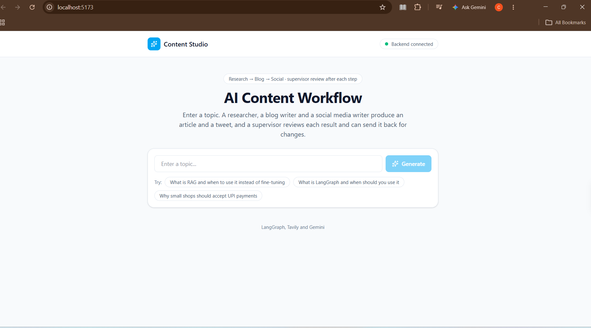
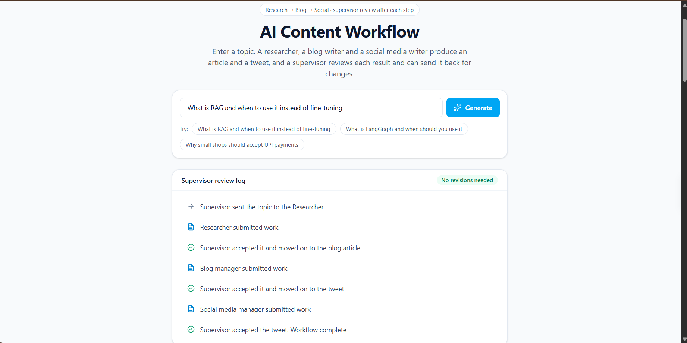
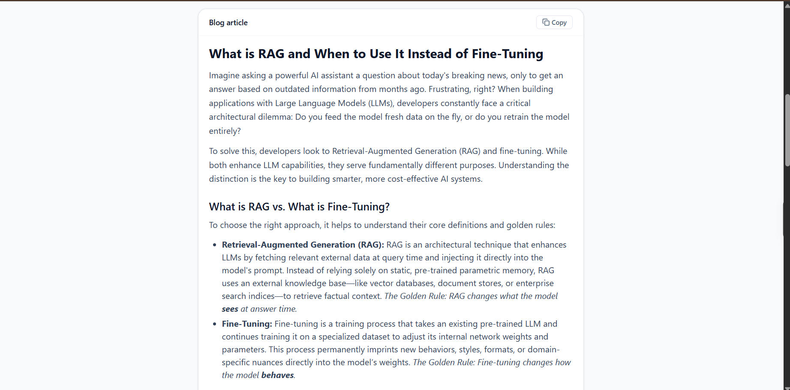
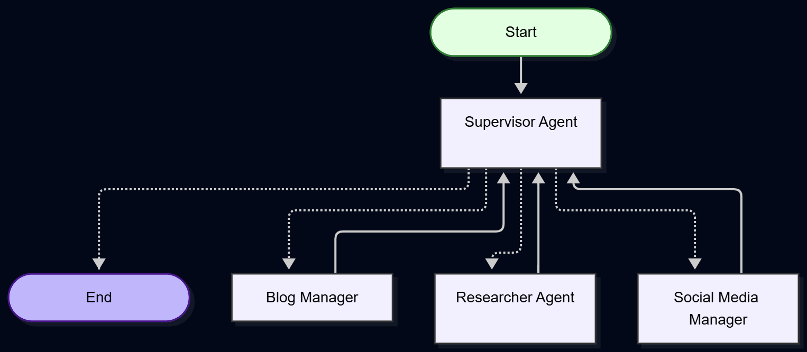
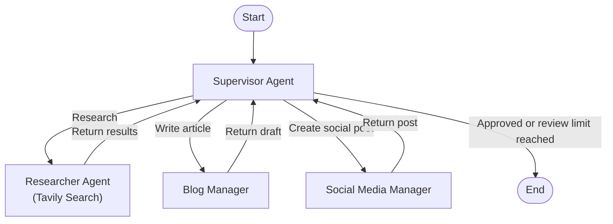

# ✍️ AI Content Studio: Supervised LangGraph Workflow

A full-stack content generation pipeline built with **LangGraph**, **FastAPI**, and **React**.

Enter a topic, and the workflow executes a structured pipeline: web research via a search agent, followed by blog and social generation nodes. A central **Supervisor** reviews every output against quality criteria, provides feedback if revisions are needed, and caps reviews at 2 attempts to keep the process moving.

---

## 💡 The Problem & The Idea

Most LLM pipelines run in a single shot: prompt in, unverified text out. If the model hallucinates, misses sources, or strays off-topic, nothing catches it.

This project introduces a **supervised feedback loop**:
1. **Fact Gathering**: A **Researcher Agent** searches the live web using Tavily.
2. **Editorial Review**: A **Supervisor node** checks the facts and sources. If incomplete, it sends the draft back with revision notes.
3. **Drafting & Refining**: Specialized **LLM nodes** draft the blog article and social post—each reviewed by the supervisor before proceeding.
4. **Circuit Breaker**: Each step is capped at **2 review attempts**, ensuring the pipeline never gets stuck in an infinite revision loop.

---

## 📸 Screenshots

### 1. Topic Input & Interface
<p align="center">
  
</p>

### 2. Supervisor Review Timeline
The UI displays every submission, revision request with specific notes, and stage approval.
<p align="center">
  
</p>

### 3. Generated Article & Social Post
<p align="center">
  
</p>

---

## 🏗 Workflow Architecture

Every worker node returns **exclusively to the supervisor**. Nodes never hand off directly to each other.

<p align="center">
  
</p>


```

---

## 🧩 Pipeline Components

| Component | Type | Responsibility | Implementation |
|---|---|---|---|
| **Supervisor** | Control Node | Evaluates drafts, issues feedback notes, and routes next step | LangGraph `Command` routing + Pydantic `Verdict` schema |
| **Researcher** | ReAct Agent | Searches the live web for facts, figures, and sources | `create_react_agent` with Tavily Search tool (`max_results=3`) |
| **Blog Writer** | LLM Node | Transforms research notes into an SEO-friendly article | Gemini 3.5 Flash Lite prompt (`.text` extraction) |
| **Social Writer**| LLM Node | Crafts a punchy tweet (< 280 chars) with hashtags | Gemini 3.5 Flash Lite prompt |

---

## ⚡ Quickstart

### 1. Environment Setup
Create a `.env` file in the project root:
```env
GOOGLE_API_KEY=your_gemini_api_key
TAVILY_API_KEY=your_tavily_api_key
```

### 2. Start Backend (FastAPI + LangGraph)
```powershell
python -m uv run python server.py
```
> Runs at **`http://127.0.0.1:8000`** · Health check: `GET /health`

### 3. Start Frontend (React + Vite)
```powershell
cd frontend
npm install
npm run dev
```
> Open **`http://localhost:5173`** to use the application.

---

## 🛠 Tech Stack

- **Orchestration:** [LangGraph](https://github.com/langchain-ai/langgraph), [LangChain](https://github.com/langchain-ai/langchain)
- **Model:** Google Gemini 3.5 Flash Lite (`langchain-google-genai`)
- **Agent Tool:** Tavily Search (`langchain-tavily`)
- **Backend:** FastAPI, Uvicorn, Pydantic
- **Frontend:** React 19, TypeScript, Vite, Tailwind CSS v4, Lucide Icons, React Markdown
